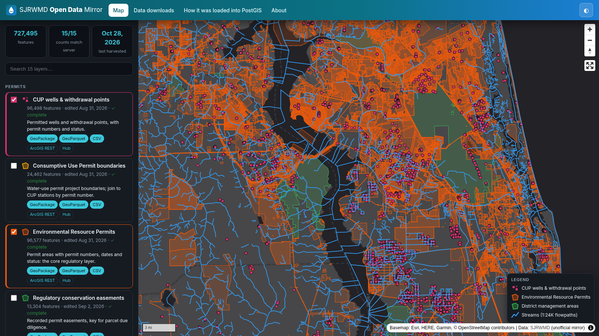
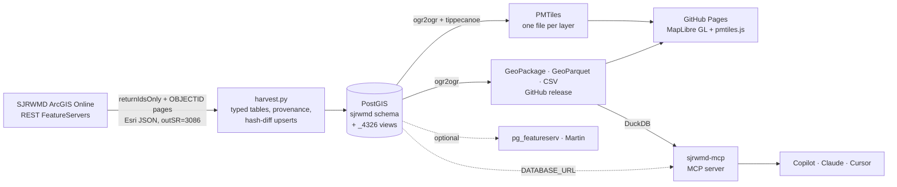

<div align="center">

# 💧 SJRWMD Open Data Mirror

[](https://scorecard.dev/viewer/?uri=github.com/knightchrism/sjrwmd-open-data)

**15 Florida water-management GIS layers, 727,495 features: harvested from ArcGIS REST into PostGIS, served as PMTiles on a static map, free to download.**

[](https://knightchrism.github.io/sjrwmd-open-data/)
[](https://knightchrism.github.io/sjrwmd-open-data/#downloads)

[](LICENSE)
[](DATA-LICENSE.md)
[](https://knightchrism.github.io/sjrwmd-open-data/)
[](https://knightchrism.github.io/sjrwmd-open-data/)


<a href="https://knightchrism.github.io/sjrwmd-open-data/"></a>

</div>

An open, reproducible, **unofficial** mirror of public data from the [St. Johns River Water Management District](https://www.sjrwmd.com) (18 counties of northeast and east-central Florida).
No tile server and no backend: one static GitHub Pages site streams each layer from a single PMTiles file with HTTP range requests.

## The 15 layers
Five polygon, five point and five line layers, chosen for usefulness and for clean API use: stable IDs, typed date and status fields, easy joins.
Every load is checked against the server's feature count; **all 15 match**.

| Layer | Type | Features | PostGIS view | Download |
|---|---|--:|---|---|
| 🟧 **Environmental Resource Permits**<br><sub>Permit areas with permit numbers, dates and status: the core regulatory layer</sub> | Polygon | 96,577 | `sjrwmd.erp` | [GeoPackage](https://github.com/knightchrism/sjrwmd-open-data/releases/download/data-2026-10-28/erp.gpkg) · [GeoParquet](https://github.com/knightchrism/sjrwmd-open-data/releases/download/data-2026-10-28/erp.parquet) · [CSV](https://github.com/knightchrism/sjrwmd-open-data/releases/download/data-2026-10-28/erp.csv.zip) |
| 🟨 **Consumptive Use Permit boundaries**<br><sub>Water-use permit project boundaries; join to CUP stations by permit number</sub> | Polygon | 24,462 | `sjrwmd.cup_boundary` | [GeoPackage](https://github.com/knightchrism/sjrwmd-open-data/releases/download/data-2026-10-28/cup_boundary.gpkg) · [GeoParquet](https://github.com/knightchrism/sjrwmd-open-data/releases/download/data-2026-10-28/cup_boundary.parquet) · [CSV](https://github.com/knightchrism/sjrwmd-open-data/releases/download/data-2026-10-28/cup_boundary.csv.zip) |
| 🟩 **Regulatory conservation easements**<br><sub>Recorded permit easements, key for parcel due diligence</sub> | Polygon | 13,304 | `sjrwmd.conservation_easement` | [GeoPackage](https://github.com/knightchrism/sjrwmd-open-data/releases/download/data-2026-10-28/conservation_easement.gpkg) · [GeoParquet](https://github.com/knightchrism/sjrwmd-open-data/releases/download/data-2026-10-28/conservation_easement.parquet) · [CSV](https://github.com/knightchrism/sjrwmd-open-data/releases/download/data-2026-10-28/conservation_easement.csv.zip) |
| 🟩 **District management areas**<br><sub>District-managed conservation lands, with manager and acres</sub> | Polygon | 133 | `sjrwmd.management_area` | [GeoPackage](https://github.com/knightchrism/sjrwmd-open-data/releases/download/data-2026-10-28/management_area.gpkg) · [GeoParquet](https://github.com/knightchrism/sjrwmd-open-data/releases/download/data-2026-10-28/management_area.parquet) · [CSV](https://github.com/knightchrism/sjrwmd-open-data/releases/download/data-2026-10-28/management_area.csv.zip) |
| 🟨 **Land cover / land use 2020**<br><sub>Latest district land use/land cover (FLUCCS) vintage</sub> | Polygon | 309,325 | `sjrwmd.land_use_2020` | [GeoPackage](https://github.com/knightchrism/sjrwmd-open-data/releases/download/data-2026-10-28/land_use_2020.gpkg) · [GeoParquet](https://github.com/knightchrism/sjrwmd-open-data/releases/download/data-2026-10-28/land_use_2020.parquet) · [CSV](https://github.com/knightchrism/sjrwmd-open-data/releases/download/data-2026-10-28/land_use_2020.csv.zip) |
| 📍 **CUP wells & withdrawal points**<br><sub>Permitted wells and withdrawal points, with permit numbers and status</sub> | Point | 96,498 | `sjrwmd.cup_station` | [GeoPackage](https://github.com/knightchrism/sjrwmd-open-data/releases/download/data-2026-10-28/cup_station.gpkg) · [GeoParquet](https://github.com/knightchrism/sjrwmd-open-data/releases/download/data-2026-10-28/cup_station.parquet) · [CSV](https://github.com/knightchrism/sjrwmd-open-data/releases/download/data-2026-10-28/cup_station.csv.zip) |
| 📍 **Well completion permits**<br><sub>District-issued well construction permits, with dates</sub> | Point | 20,438 | `sjrwmd.well_completion` | [GeoPackage](https://github.com/knightchrism/sjrwmd-open-data/releases/download/data-2026-10-28/well_completion.gpkg) · [GeoParquet](https://github.com/knightchrism/sjrwmd-open-data/releases/download/data-2026-10-28/well_completion.parquet) · [CSV](https://github.com/knightchrism/sjrwmd-open-data/releases/download/data-2026-10-28/well_completion.csv.zip) |
| 📍 **Monitoring stations (EDR)**<br><sub>Hydrologic and water-quality monitoring stations</sub> | Point | 4,879 | `sjrwmd.edr_station` | [GeoPackage](https://github.com/knightchrism/sjrwmd-open-data/releases/download/data-2026-10-28/edr_station.gpkg) · [GeoParquet](https://github.com/knightchrism/sjrwmd-open-data/releases/download/data-2026-10-28/edr_station.parquet) · [CSV](https://github.com/knightchrism/sjrwmd-open-data/releases/download/data-2026-10-28/edr_station.csv.zip) |
| 📍 **2025 Status & Trends: surface water**<br><sub>2025 Status & Trends surface-water stations</sub> | Point | 2,691 | `sjrwmd.st2025_surface_water` | [GeoPackage](https://github.com/knightchrism/sjrwmd-open-data/releases/download/data-2026-10-28/st2025_surface_water.gpkg) · [GeoParquet](https://github.com/knightchrism/sjrwmd-open-data/releases/download/data-2026-10-28/st2025_surface_water.parquet) · [CSV](https://github.com/knightchrism/sjrwmd-open-data/releases/download/data-2026-10-28/st2025_surface_water.csv.zip) |
| 📍 **2025 Status & Trends: groundwater**<br><sub>2025 Status & Trends groundwater stations</sub> | Point | 1,592 | `sjrwmd.st2025_groundwater` | [GeoPackage](https://github.com/knightchrism/sjrwmd-open-data/releases/download/data-2026-10-28/st2025_groundwater.gpkg) · [GeoParquet](https://github.com/knightchrism/sjrwmd-open-data/releases/download/data-2026-10-28/st2025_groundwater.parquet) · [CSV](https://github.com/knightchrism/sjrwmd-open-data/releases/download/data-2026-10-28/st2025_groundwater.csv.zip) |
| 〰️ **Streams (1:24K flowpaths)**<br><sub>District 1:24K stream network, more detailed than USGS 100K</sub> | Line | 105,354 | `sjrwmd.stream_flowpath` | [GeoPackage](https://github.com/knightchrism/sjrwmd-open-data/releases/download/data-2026-10-28/stream_flowpath.gpkg) · [GeoParquet](https://github.com/knightchrism/sjrwmd-open-data/releases/download/data-2026-10-28/stream_flowpath.parquet) · [CSV](https://github.com/knightchrism/sjrwmd-open-data/releases/download/data-2026-10-28/stream_flowpath.csv.zip) |
| 〰️ **Reclaimed-water lines**<br><sub>Reclaimed-water lines reported to the district</sub> | Line | 50,108 | `sjrwmd.reuse_line` | [GeoPackage](https://github.com/knightchrism/sjrwmd-open-data/releases/download/data-2026-10-28/reuse_line.gpkg) · [GeoParquet](https://github.com/knightchrism/sjrwmd-open-data/releases/download/data-2026-10-28/reuse_line.parquet) · [CSV](https://github.com/knightchrism/sjrwmd-open-data/releases/download/data-2026-10-28/reuse_line.csv.zip) |
| 〰️ **Management-area roads**<br><sub>Roads on district lands</sub> | Line | 1,592 | `sjrwmd.management_area_road` | [GeoPackage](https://github.com/knightchrism/sjrwmd-open-data/releases/download/data-2026-10-28/management_area_road.gpkg) · [GeoParquet](https://github.com/knightchrism/sjrwmd-open-data/releases/download/data-2026-10-28/management_area_road.parquet) · [CSV](https://github.com/knightchrism/sjrwmd-open-data/releases/download/data-2026-10-28/management_area_road.csv.zip) |
| 〰️ **Management-area trails**<br><sub>Public recreation trails on district lands</sub> | Line | 401 | `sjrwmd.management_area_trail` | [GeoPackage](https://github.com/knightchrism/sjrwmd-open-data/releases/download/data-2026-10-28/management_area_trail.gpkg) · [GeoParquet](https://github.com/knightchrism/sjrwmd-open-data/releases/download/data-2026-10-28/management_area_trail.parquet) · [CSV](https://github.com/knightchrism/sjrwmd-open-data/releases/download/data-2026-10-28/management_area_trail.csv.zip) |
| 〰️ **Upper Floridan potentiometric surface (2010)**<br><sub>Latest (Sep 2010) Upper Floridan aquifer potentiometric contours</sub> | Line | 141 | `sjrwmd.ufa_potentiometric_2010` | [GeoPackage](https://github.com/knightchrism/sjrwmd-open-data/releases/download/data-2026-10-28/ufa_potentiometric_2010.gpkg) · [GeoParquet](https://github.com/knightchrism/sjrwmd-open-data/releases/download/data-2026-10-28/ufa_potentiometric_2010.parquet) · [CSV](https://github.com/knightchrism/sjrwmd-open-data/releases/download/data-2026-10-28/ufa_potentiometric_2010.csv.zip) |

GeoPackage is EPSG:3086 (Florida GDL Albers, meters); GeoParquet and CSV (WKT) are EPSG:4326. Checksums: `SHA256SUMS` in the release.

## Architecture


## 🤖 Ask the data with AI (MCP)
`sjrwmd-mcp` is a read-only [MCP](https://modelcontextprotocol.io) server for these 15 layers: `find_near`, `features_in_bbox`, `search_attributes`, `count_by`, `get_feature`, `describe_layer`, `list_layers`.
It reads the published GeoParquet with DuckDB (no database needed), or your PostGIS via `DATABASE_URL`. See the [recorded example runs](https://knightchrism.github.io/sjrwmd-open-data/#demo) and [docs/API-MCP.md](docs/API-MCP.md).

### Use with GitHub Copilot in VS Code
1. Install [uv](https://docs.astral.sh/uv/getting-started/installation/) (for `uvx`).
2. Clone this repo and open it in VS Code: [`.vscode/mcp.json`](.vscode/mcp.json) is already here. Or add it to any workspace:
   ```json
   { "servers": { "sjrwmd": { "type": "stdio", "command": "uvx",
       "args": ["--from", "git+https://github.com/knightchrism/sjrwmd-open-data#subdirectory=mcp", "sjrwmd-mcp"] } } }
   ```
   Click **Start** above the server entry.
3. Open Copilot Chat, switch to **Agent** mode, and tick the **sjrwmd** tools in the tools picker.
4. Ask:
   - *"Which permitted water-use wells are within 2 miles of downtown DeLand?"* → `find_near` returns wells sorted by distance, with type, status and permit project.
   - *"Which counties have the most ERP permits?"* → `count_by`: Duval 15,438 · Brevard 12,520 · Orange 12,382 · …
   - *"Show the trails in the Lake Norris Conservation Area."* → `search_attributes` + `features_in_bbox`: 6 trail segments with blaze, uses and miles.
   - *"Which monitoring stations are within 3 miles of Lake George?"* → `find_near` on `edr_station`.

**Claude Desktop / Cursor:** same command under `"mcpServers"` (see [API-MCP.md](docs/API-MCP.md#other-clients)). A public web chat would need a hosted model, so none is included.
Answers come from an unofficial copy of SJRWMD data; verify anything important.

## ☸️ Run on Kubernetes

`deploy/k8s/` has a Kustomize base (namespace, PostGIS StatefulSet, weekly harvester CronJob, pg_featureserv, Martin, MCP server over streamable HTTP) plus `local` and `cloud` overlays. Walkthrough: [Run on Kubernetes](https://knightchrism.github.io/sjrwmd-open-data/k8s.html).

```bash
# create the sjrwmd-db Secret first (see deploy/k8s/base/secret.example.yaml); no passwords are committed
kubectl apply -k deploy/k8s/overlays/local
```
The `cloud` overlay's public ingress requires HTTP basic auth (Secret `sjrwmd-basic-auth`, see `deploy/k8s/overlays/cloud/ingress.yaml`) and the MCP server only accepts Host headers listed in `SJRWMD_MCP_ALLOWED_HOSTS`.

## Quickstart
```bash
git clone https://github.com/knightchrism/sjrwmd-open-data && cd sjrwmd-open-data
cp .env.example .env                  # set POSTGRES/LOADER/READER passwords (required; .env is git-ignored)
docker compose up -d db               # PostGIS 17-3.5, runs sql/01_init.sql
python -m venv .venv && .venv/bin/pip install -r requirements.txt
set -a; . ./.env; set +a
.venv/bin/python harvest.py           # 15 layers, ~727k features, ~10 min; reruns skip unchanged layers
psql -f qc/qc.sql                     # loaded vs. server counts
bash scripts/build_tiles.sh docs/tiles && bash scripts/export.sh dist   # needs tippecanoe + GDAL
python scripts/build_site_data.py && npx http-server docs              # preview the site
```
Options: `--only erp cup_station`, `--force`, `--all` (every layer in `esri_inventory.csv`).
On Windows, clone into a local folder such as `C:\dev` (not OneDrive) and run the same steps in PowerShell with Docker Desktop.

The full walkthrough (ArcGIS REST, paging, reprojection, typed tables, provenance, incremental updates, example SQL) is on the site: **[How it was loaded into PostGIS](https://knightchrism.github.io/sjrwmd-open-data/howto.html)**.

## Repository map
| Path | What |
|---|---|
| `harvest.py`, `layers.yaml` | Harvester and the 15-layer selection (with a reason per layer) |
| `sql/01_init.sql`, `qc/qc.sql` | Schemas, roles, registry; load-count check |
| `scripts/build_tiles.sh`, `scripts/export.sh`, `scripts/build_site_data.py` | PMTiles, downloads, site catalog |
| `docs/` | The static site (MapLibre GL, pmtiles.js); `docs/demo/` recorded MCP runs |
| `mcp/`, `.vscode/mcp.json` | The `sjrwmd-mcp` server (DuckDB or PostGIS), tests, VS Code config |
| `docker-compose.yml` | PostGIS, pg_featureserv, Martin |
| `.github/workflows/weekly-update.yml` | Weekly refresh, **disabled** until enabled with the `HARVEST_ENABLED` variable |

## Credits
- **Data:** © [St. Johns River Water Management District](https://www.sjrwmd.com), Florida public records (Ch. 119, F.S.). This is an unofficial copy, not affiliated with or endorsed by SJRWMD, provided as-is with no warranty. See the [SJRWMD disclaimer](https://www.sjrwmd.com/disclaimer/) and [DATA-LICENSE.md](DATA-LICENSE.md). Authoritative source: [data-floridaswater.opendata.arcgis.com](https://data-floridaswater.opendata.arcgis.com).
- **Built with:** PostGIS, GDAL, [tippecanoe](https://github.com/felt/tippecanoe), [PMTiles](https://github.com/protomaps/PMTiles), [MapLibre GL JS](https://maplibre.org), Shapely, psycopg. Basemap: Esri Light/Dark Gray Canvas.
- **Author:** Christopher Knight ([GeoKnight GIS](https://github.com/knightchrism)). Code under the [MIT License](LICENSE).
